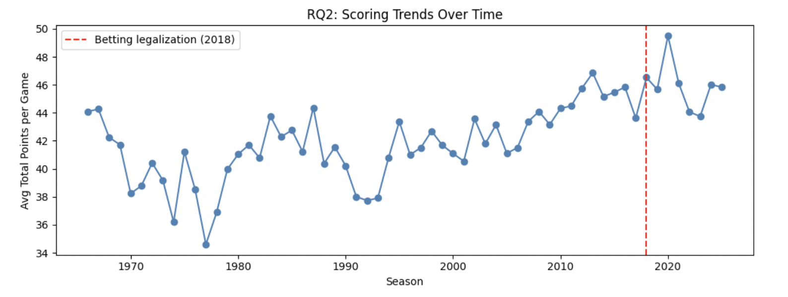
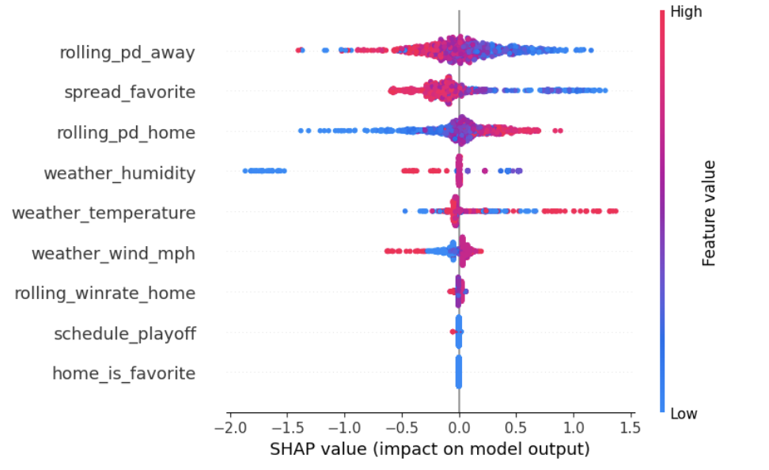

# Predicting NFL Game Outcomes with Machine Learning

Can pregame information (betting lines, recent team form and weather) predict who wins an NFL game? And did the game itself change after U.S. sports betting was legalized in 2018 (*Murphy v. NCAA*)?

Capstone project for STAT/CSCI 4990, University of Georgia (Spring 2026).



## Research questions

1. Which pregame features matter most for predicting game outcomes?
2. Did scoring patterns change after sports betting was legalized?
3. Do models perform differently in the playoffs than in the regular season?

## Data

[NFL scores and betting data](https://www.kaggle.com/datasets/tobycrabtree/nfl-scores-and-betting-data) (Kaggle, "spreadspoke"): 14,000+ games from 1966 to 2024, with scores, point spreads and game-time weather. Modeling uses games from 2018 onward (2,213 games after cleaning).

## Approach

- **Features:** rolling 5-game point differential and win rate for each team, point spread, favorite indicator, temperature, wind, humidity and playoff flag. Rolling stats are computed on the full history before filtering so early-2018 games have prior form.
- **Split:** chronological, with training on 2018–2022 and testing on 2023–2024 (no random shuffling, to avoid look-ahead leakage).
- **Models:** logistic regression (baseline), random forest and XGBoost, tuned with grid search and 3-fold CV.
- **Evaluation:** accuracy, log loss, calibration curves and SHAP values.

## Results

| Model | Test accuracy | Log loss |
|---|---|---|
| Logistic regression | 61.2% | 0.654 |
| **Random forest** | **62.5%** | **0.653** |
| XGBoost | 58.7% | 0.685 |

The home team wins about 57% of games historically, so the best model adds a modest but real edge over that baseline.

- **Feature importance (RQ1):** the away team's recent point differential, the point spread and the home team's recent point differential drive predictions most.

  
- **Scoring after 2018 (RQ2):** average total points rose from 41.8 to 45.9 per game, margins of victory narrowed (12.0 → 11.2) and the share of one-score games (within 7 points) rose from 44% to 49%. All differences are significant at p < 0.001.
- **Playoffs vs regular season (RQ3):** XGBoost dropped to 44% accuracy on playoff games, while logistic regression held up (67%, though there are only 39 playoff games in the test set).
- **Case study, Super Bowl LVII:** only logistic regression correctly picked the Chiefs (38–35 over the Eagles).

The full write-up is in [`report/final_report.pdf`](report/final_report.pdf).

## Limitations and next steps

- **`home_is_favorite` is always 0 (known bug).** The feature compares `team_favorite_id`, an abbreviation such as `KC`, with `team_home`, a full name such as `Kansas City Chiefs`, so the two never match. The model therefore gets no information from it, which is why its SHAP importance is exactly zero. The fix is to map team names to IDs with `data/nfl_teams.csv` before comparing:
  ```python
  teams = pd.read_csv('../data/nfl_teams.csv')
  name_to_id = dict(zip(teams.team_name, teams.team_id))
  sports_data['home_is_favorite'] = (
      sports_data['team_home'].map(name_to_id) == sports_data['team_favorite_id']
  ).astype(int)
  ```
  The point spread still carries most of the betting-market signal, so results should shift only modestly once this is fixed.
- **Small playoff sample.** The test set has only 39 playoff games, so the RQ3 comparisons are noisy.
- **Possible leakage from betting variables.** The point spread reflects market expectations and may encode information the other features lack, which makes the features harder to interpret.

## Repository layout

```
├── data/          raw Kaggle CSVs
├── figures/       key plots
├── notebooks/     nfl_game_prediction.ipynb (full analysis)
└── report/        final report (PDF)
```

## Running it

```bash
pip install -r requirements.txt
jupyter notebook notebooks/nfl_game_prediction.ipynb
```

## Team

Jaden Hyatt, Emily Zapata, Aditi Ravi, Anastasiya Peravalava and Senait Pirani
